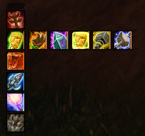

# TotemPicker Forever

[English](README.md) | Français

Barre de totems pour chaman sur World of Warcraft: Forever (interface 16001). Elle remplace la petite flèche de la barre Blizzard par des clics directs.

## Les clics

**Sur un bouton d'élément (Terre, Feu, Eau, Air)**
- Clic gauche : pose le totem actif de l'élément.
- Clic droit : ouvre ou ferme la liste des totems de l'élément.

**Dans la liste des totems**
- Clic gauche : le pose, sans changer le totem actif.
- Clic droit : en fait le totem actif, sans le poser. Il est aussi inscrit dans la barre de totems du jeu, donc Appel des éléments le posera.
- Clic milieu : le pose et en fait le totem actif.

**Bouton d'appel (Appel des éléments / des ancêtres / des esprits)**
- Clic gauche : lance l'appel affiché.
- Clic droit : passe à l'appel suivant (quand vous en connaissez plusieurs) et affiche son jeu de totems sur la barre.

**Rappel totémique** : clic gauche.

Tout fonctionne en combat.

## Durées et temps de recharge

- La durée restante du totem posé s'affiche sur le bouton de l'élément : temps en blanc et barre fine qui se vide.
- Les totems qui ont un vrai temps de recharge affichent le voile sombre et les secondes restantes (en jaune, au centre) sur leur icône dans la liste, et sur le bouton de l'élément quand ils sont le totem actif. Le temps de recharge global est ignoré.

## Réglages (/tpk)

Taille des icônes, espacement entre les icônes, espacement dans les listes, sens de la barre (horizontale ou verticale), direction d'ouverture des listes (automatique, haut, bas, gauche, droite), affichage des boutons d'appel et de rappel, liseré de couleur par élément, durée et temps de recharge des totems, fermeture de la liste après un clic, infobulles, masquage de la barre Blizzard, verrouillage, langue (langue du jeu, English ou Français, appliquée après un rechargement).

**Poignée au bout de la barre** (bleue si déverrouillée, noire translucide si verrouillée) :
- Clic gauche et glisser : déplacer la barre (si déverrouillée).
- Maj + clic droit : verrouiller / déverrouiller.
- Maj + clic milieu : ouvrir les options.

## Commandes

- `/tpk` : options
- `/tpk lock` / `/tpk unlock` : verrouiller / déverrouiller
- `/tpk reset` : remettre la barre au centre
- `/tpk diag` : diagnostic à envoyer en cas de problème

## Raccourcis clavier

Échap > Options > Raccourcis > AddOns > TotemPicker Forever : un raccourci par élément, l'appel actuel et le Rappel totémique.

## Remarque

En combat, le jeu masque certaines données aux addons. La durée affichée sur les totems peut alors disparaître, et les temps de recharge sont dessinés par le jeu lui-même (chiffres visibles si l'option du jeu « afficher les chiffres de recharge » est activée). Les clics, eux, continuent de fonctionner.

Auteur : Doel
